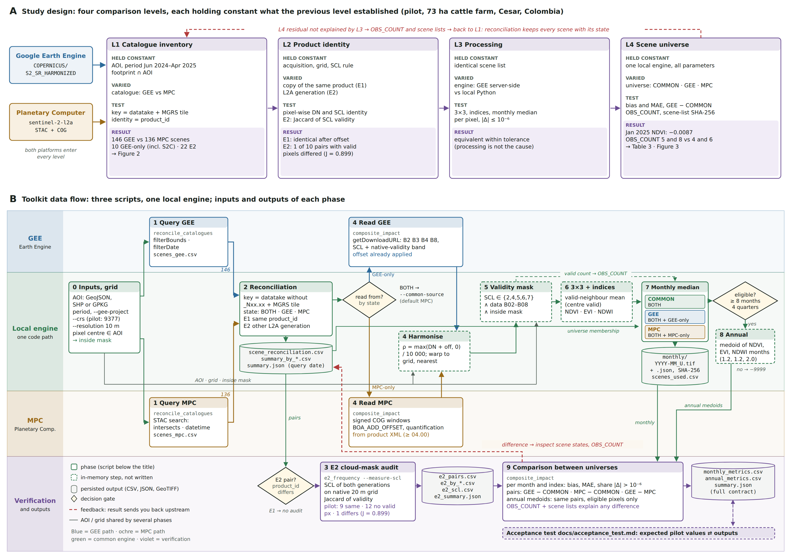

# gee-mpc-sentinel2-validation

[](https://github.com/hapantevezv-collab/gee-mpc-sentinel2-validation/actions/workflows/tests.yml)
[](https://doi.org/10.5281/zenodo.23407223)
[](https://doi.org/10.31223/X5SC0B)
[](https://doi.org/10.5281/zenodo.23241823)

Tools to check whether it is safe to combine **Sentinel‑2 L2A** imagery from
**Google Earth Engine (GEE)** and **Microsoft Planetary Computer (MPC)** in one
time series.

A pilot case over a cattle farm in Cesar (Colombia) showed three things:

- **With the same scenes, the two platforms produce the same indices.** The SCL
  mask, harmonised reflectance and the processing chain (mask, 3 × 3 smoothing,
  NDVI, EVI, NDWI and monthly median) agree pixel by pixel.
- **The catalogues do not hold the same scenes.** Between June 2024 and April
  2025, 10 of 146 scene–tile records over the area existed only in GEE, six of
  them from Sentinel‑2C. In the two months tested, those scenes shifted the
  monthly mean NDVI by −0.0005 (Dec 2024) and −0.0087 (Jan 2025); over the public
  demonstration area, by up to −0.028 (Jan 2025).
- **The same acquisition can come in different versions.** In 22 of 136 common
  records, all from June and July 2024, the catalogues held different L2A
  generations. Of the 10 pairs with valid pixels, one had a different cloud mask.

Preprint (EarthArXiv, latest version): https://doi.org/10.31223/X5SC0B.
Data, version 1.0.0 of the code and preprint version 1: https://doi.org/10.5281/zenodo.23241823.
A Spanish-language guide with results and lessons learned is in
[`docs/guide_es.html`](docs/guide_es.html).

## Installation

Requires Python 3.10 or later and, for the commands that query catalogues, a Google
Earth Engine account with an enabled Google Cloud project. MPC needs no account.

```bash
pip install git+https://github.com/hapantevezv-collab/gee-mpc-sentinel2-validation.git
earthengine authenticate          # on servers: earthengine authenticate --auth_mode=notebook
```

## Usage

The area of interest can be a GeoJSON, shapefile or GeoPackage with one or more
polygons and a declared coordinate reference system.

```bash
# 1. Reconcile catalogues (metadata only; fast)
gee-mpc-reconcile --aoi aoi.geojson --start 2024-01-01 --end 2025-06-30 \
    --gee-project MY_PROJECT --out reconciliation

# 2. Frequency of different L2A generations (E2) and effect on the SCL
gee-mpc-e2 --reconciliation reconciliation/scene_reconciliation.csv \
    --measure-scl --aoi aoi.geojson --gee-project MY_PROJECT --out e2

# 3. Effect of the scene universe on composites (start with the months that differ)
gee-mpc-impact --reconciliation reconciliation/scene_reconciliation.csv \
    --aoi aoi.geojson --gee-project MY_PROJECT --only-months-with-difference --out impact
```

Each command describes its options with `--help`. The v1.0.0 scripts
(`python scripts/reconcile_catalogues.py ...`) still work and run the same code.

### Run the acceptance test on the public AOI

```bash
gee-mpc-reconcile --aoi data/demo_aoi.geojson --start 2024-06-01 --end 2025-04-30 \
    --gee-project MY_PROJECT --out demo_reconciliation
gee-mpc-e2 --reconciliation demo_reconciliation/scene_reconciliation.csv --measure-scl \
    --aoi data/demo_aoi.geojson --gee-project MY_PROJECT --out demo_e2
gee-mpc-impact --reconciliation demo_reconciliation/scene_reconciliation.csv \
    --aoi data/demo_aoi.geojson --gee-project MY_PROJECT --crs EPSG:9377 \
    --max-cloud 20 --only-months-with-difference --out demo_impact
gee-mpc-verify-demo --ref data/acceptance/demo \
    --reconciliation demo_reconciliation --e2 demo_e2 --impact demo_impact
```

The reference outputs, expected values and SHA-256 hashes are in
`data/acceptance/demo/` (catalogues queried on 8 October 2026). Catalogues change over
time: a difference in the reconciliation can mean that a catalogue changed.

## Workflow



| Phase | Command | Input | Output |
|---|---|---|---|
| 0 Inputs and grid | all three | AOI, period, `--crs`, `--resolution` | grid and AOI mask (in memory) |
| 1 Query | `gee-mpc-reconcile` | AOI and period | `scenes_gee.csv`, `scenes_mpc.csv` |
| 2 Reconciliation | `gee-mpc-reconcile` | phase 1 listings | `scene_reconciliation.csv`, `summary_by_*.csv`, `summary.json` |
| 3 E2 audit | `gee-mpc-e2` | E2 pairs from phase 2, AOI | `e2_pairs.csv`, `e2_by_*.csv`, `e2_scl.csv`, `e2_summary.json` |
| 4 Read and harmonise | `gee-mpc-impact` | state of each scene, grid | reflectance and SCL per scene (in memory) |
| 5–6 Mask, 3 × 3, indices | `gee-mpc-impact` | phase 4, AOI mask | NDVI, EVI, NDWI per scene (in memory) |
| 7 Monthly median | `gee-mpc-impact` | indices, universe membership | `monthly/YYYY-MM_U.tif` + `.json`, `scenes_used.csv` |
| 8 Annual composite | `gee-mpc-impact` | ≥ 8 months, 4 quarters | medoid per universe (in memory) |
| 9 Comparison | `gee-mpc-impact` | phases 7 and 8 | `monthly_metrics.csv`, `annual_metrics.csv`, `summary.json` |

The annual composite is implemented but was not evaluated in the preprint.

## Repository layout

| Path | Content |
|---|---|
| `src/gee_mpc_s2val/` | Package: `reconcile.py`, `e2.py`, `impact.py`, `radiometry.py`, `verify.py`, `cli.py` |
| `scripts/` | Wrappers for the v1.0.0 commands |
| `tests/` | Unit tests and offline acceptance tests (pytest) |
| `data/demo_aoi.geojson` | Public 1 km × 1 km AOI in the overlap of tiles T18PXS and T18PYS |
| `data/acceptance/demo/` | Reference outputs, `acceptance_demo.json` and `SHA256SUMS.txt` |
| `docs/` | Guide (Spanish), acceptance test, data dictionary (`data_dictionary.md`, `.csv`), workflow figures |

## Tests

```bash
pip install -e ".[test]"
pytest -m "not ee"                 # offline: unit tests and acceptance from published outputs
GEE_PROJECT=MY_PROJECT pytest      # also queries the live catalogues
```

## Lessons from the pilot built into the code

1. **Reconcile by acquisition, not by text.** The key is the datatake without
   baseline suffix plus the MGRS tile. No scene is dropped silently.
2. **Product identity.** Matching date and datatake is not enough; the
   `product_id` is compared (E1 same product, E2 other L2A generation).
3. **Explicit radiometry.** Reflectance = max(DN + BOA_ADD_OFFSET, 0) / 10 000.
   GEE already applies the offset; in MPC it is read from the product XML.
4. **Unambiguous no-data.** GEE validity is downloaded as its own band, because a
   harmonised DN = 0 is a real value. Outputs use −9999.
5. **Provenance inside the product.** Each GeoTIFF carries an `OBS_COUNT` band and
   the SHA‑256 of its scene list.
6. **One engine.** Differences between universes come only from the scenes.

## How to cite

Pantevez Villamil, H. A. (2026). *Same computation, different scenes: a single-site
comparison of Sentinel‑2 L2A composites from Google Earth Engine and Microsoft
Planetary Computer* [Preprint]. EarthArXiv. https://doi.org/10.31223/X5SC0B

Data and version 1.0.0 of the code: Zenodo. https://doi.org/10.5281/zenodo.23241823

To cite the software itself:

Pantevez Villamil, H. A. (2026). *gee-mpc-sentinel2-validation* (Version 1.1.0) [Software]. Zenodo.
https://doi.org/10.5281/zenodo.23407223

See also `CITATION.cff`.

## Licence

- Code (`src/`, `scripts/`, `tests/`): [MIT](LICENSE).
- Documentation and data (`README.md`, `docs/`, `data/`): [CC BY 4.0](LICENSE-docs.md).

## Author

Heiber Alexander Pantevez Villamil · hapantevezv@unal.edu.co ·
[ORCID 0000-0003-1797-0057](https://orcid.org/0000-0003-1797-0057)
Doctorado en Agroecología, Facultad de Ciencias Agropecuarias,
Universidad Nacional de Colombia, Sede Palmira.
Internal mobility: Facultad de Ciencias Agrarias, Universidad Nacional de Colombia, Sede Bogotá.

## Use of generative artificial intelligence

Generative AI assistants (Claude, Anthropic, and ChatGPT, OpenAI) supported test
design, code writing and debugging, literature review and documentation. The author
defined the research design, ran all code in his own environment, verified the
results and is responsible for the content.

## Data and privacy

The repository does not include the pilot farm geometry, rasters, Earth Engine
credentials or project identifiers. The scripts work on any area the user defines.
